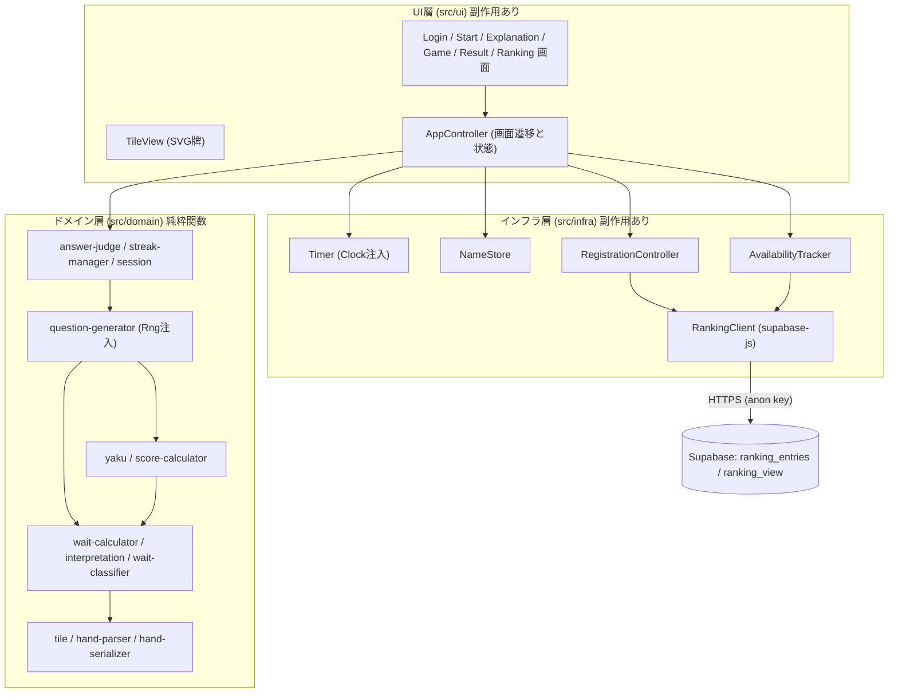
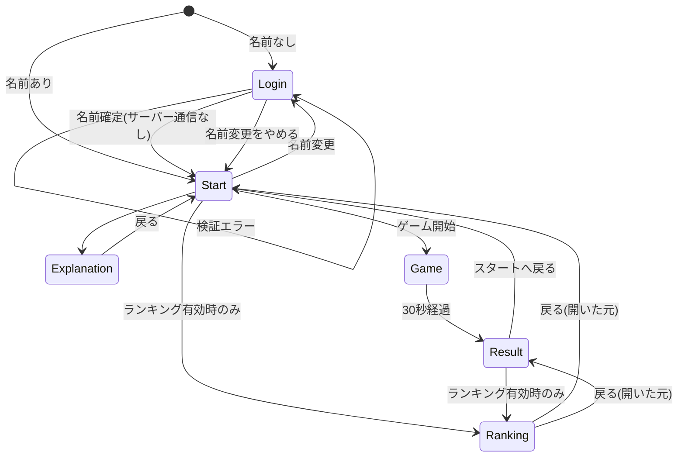
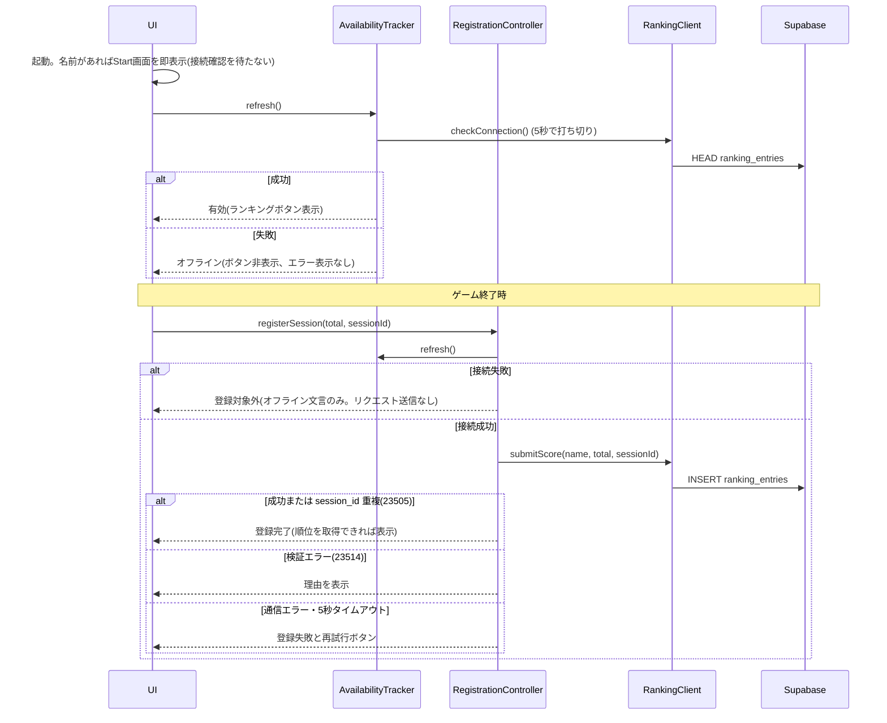

# 設計書: 麻雀待ち当てタイムアタック (mahjong-machi-quiz-game)

## Overview

13枚のテンパイ手牌を提示し、待ち牌をすべて当てる30秒のタイムアタックゲームを、TypeScript 製のブラウザアプリとして実現する。正解した問題の点数(子・ロン・門前・リーチ・ドラなし・東場南家の和了点)を合計して競う。ランキングのみ Supabase(supabase-js でブラウザから直接接続)を利用し、接続できない場合はランキング機能を無効化してゲーム本体は通常どおり動かす。

### 設計方針

| 方針 | 内容 | 根拠 |
|---|---|---|
| ドメインとインフラの分離 | 牌・待ち計算・点数計算・問題生成・判定・Streak は DOM、時計、乱数、ネットワークに依存しない純粋関数とする | Property-Based Testing を容易にし、要件 11.5(ゲーム進行がサーバーに依存しない)を構造で保証する |
| 副作用の注入 | 乱数(`Rng`)、時計(`Clock`)、ストレージ(`KeyValueStorage`)、ランキング通信(`RankingClient`)をインターフェースで注入する | 決定的なテストと、オフライン時の挙動の検証ができる |
| 事前計算された Question | 問題生成時に待ち牌と各待ちの点数を計算して `Question` に保持する | 回答判定を O(1) にし、回答から次問題表示まで 300ms 以内(要件 7.6)に収める |
| 単一 index.html | Vite + vite-plugin-singlefile で JS と CSS をインライン化する | 要件 15.1, 15.2 |
| 失敗を値で返す | パーサ、名前検証、通信結果は例外ではなく判別可能な共用体(`Result`)で返す | UI 側の分岐が網羅的になり、テストしやすい |

### 調査結果と採用判断

| 論点 | 検討内容 | 結論 |
|---|---|---|
| UI フレームワーク | 画面は6つで状態も単純。Preact(約4KB gzip)や lit も候補。`supabase-js` が単一ファイルの大半を占めるため、フレームワークを足しても増分は小さい | 素の TypeScript + DOM を採用。小さな `h()` ヘルパーで要素を作り、文字列は必ず `textContent` / `createTextNode` で挿入する(名前のエスケープ要件 10.7, 13.7 を構造で満たす)。画面が増えて差分更新が複雑になった場合の移行先は Preact |
| 牌の表示 | Unicode 麻雀牌(U+1F000〜U+1F021)は端末のフォントに依存し、スマホで表示されない場合がある | インライン SVG を採用。牌ごとに数字と種別(萬・筒・索)または字牌名を描いた SVG を TypeScript で生成するため、外部画像もフォントも不要で単一ファイルに収まる。34種類すべてが互いに異なる図柄になる(要件 5.2)。生成に失敗した場合は種別と数字のテキストラベルで代替する(要件 5.3) |
| Supabase の接続確認 | 「5秒以内に正常応答」が成功条件 | `ranking_entries`(または `ranking_view`)への `head: true` の軽量 SELECT を `AbortController` で5秒打ち切りにする |
| 順位 | 順位は 1 + 自分より高い点数の件数。同点は同順位 | SQL の `rank() over (order by total_score desc)` が同じ定義になる。ビューとして公開し、登録直後の順位だけは件数クエリ(`total_score > 自分の点数` の `count` + 1)で取得する |
| 名前の trim | JS の `String.prototype.trim()` は全角スペースを含む Unicode 空白を除去する。PostgreSQL の `btrim` は既定で半角スペースのみ | クライアントが trim 済みの名前を送り、サーバーは「前後に空白(`\s` と全角スペース)がないこと」を CHECK 制約で強制する |
| 単一ファイルの `file://` 動作 | インライン化された `<script type="module">` は `file://` でも実行できる。Supabase への `fetch` は CORS で許可される | 配置ファイルとしての利用(要件 15.2)が可能。`base: './'` を指定する |

参考: [vite-plugin-singlefile](https://github.com/richardtallent/vite-plugin-singlefile)、[Supabase: Row Level Security](https://supabase.com/docs/guides/database/postgres/row-level-security)、[fast-check](https://fast-check.dev/)。

## Architecture

### レイヤー構成



依存の向きは UI → インフラ → ドメインの一方向とする。ドメイン層は他の層を import しない。

### ディレクトリ構成

```
src/
  domain/
    tile.ts               # TileId, Counts, 牌名, 表示順ソート
    hand-parser.ts        # parseHand / serializeHand
    interpretation.ts     # 14枚の分解(Interpretation)の列挙
    wait-calculator.ts    # calcWaits (高速な和了判定)
    wait-classifier.ts    # 待ち形分類
    yaku.ts               # 役判定と役満検出
    score-calculator.ts   # 符・翻・点数、高点法
    rng.ts                # Rng インターフェースと seeded 実装
    question-generator.ts # 通常問題・清一色問題の生成、フォールバック
    answer-judge.ts
    streak-manager.ts
    session.ts            # ゲームセッションの純粋な状態遷移
    name-validator.ts
  infra/
    clock.ts timer.ts
    name-store.ts
    supabase-client.ts    # createClient(VITE_SUPABASE_URL, VITE_SUPABASE_ANON_KEY)
    ranking-client.ts     # RankingClient 実装とエラー分類
    availability.ts       # Ranking_Availability と Connection_Check
    registration.ts       # スコアの自動登録の制御
  ui/
    dom.ts app-controller.ts tile-view.ts screens/*.ts
  main.ts
supabase/migrations/0001_init.sql
```

### 画面遷移



`Ranking` から戻る先は `returnTo: 'start' | 'result'` として `AppState` に保持する。Result 画面の合計点、解説一覧、`Registration_Status` は `AppState.lastResult` に残るため、戻っても変わらない(要件 8.11)。Game 画面には説明画面への入口を置かない(要件 14.10)。

### ランキング関連の起動時・登録時のシーケンス

ログインと名前変更は Supabase を呼ばない(要件 13.4, 13.16)。Supabase との通信は、接続確認、スコア登録、ランキング取得だけである。



## Components and Interfaces

### ドメイン層

#### 牌と手牌 (`tile.ts`)

```ts
/** 0-8: 萬子1-9, 9-17: 筒子1-9, 18-26: 索子1-9, 27-33: 東南西北白發中 */
export type TileId = number;
export type Suit = 'm' | 'p' | 's' | 'z';
/** 長さ34の配列。counts[t] は牌種 t の枚数(0〜4) */
export type Counts = readonly number[];
/** 昇順にソートされた牌の配列。13枚(問題)または14枚(和了形) */
export type Hand = readonly TileId[];

export const suitOf: (t: TileId) => Suit;
export const numberOf: (t: TileId) => number;      // 数牌は1-9、字牌は1-7
export const toCounts: (hand: Hand) => Counts;
export const sortForDisplay: (hand: Hand) => TileId[]; // 萬→筒→索→字牌、字牌は東南西北白發中
export const tileLabel: (t: TileId) => string;         // 「3萬」「東」等(SVG生成失敗時の代替表示)
```

`TileId` の昇順がそのまま要件 5.1 の表示順(萬子、筒子、索子、字牌、数字昇順、字牌は東南西北白發中)になるよう割り当てる。

#### 手牌文字列 (`hand-parser.ts`)

```ts
export type ParseError =
  | { kind: 'invalidChar'; position: number; char: string }
  | { kind: 'missingSuit'; position: number }          // 数字列の後に種別文字がない
  | { kind: 'orphanSuit'; position: number }           // 数字なしの種別文字
  | { kind: 'honorOutOfRange'; position: number }      // z に 8, 9
  | { kind: 'redTile'; position: number }              // 0
  | { kind: 'tileCount'; count: number }               // 0枚、または15枚以上
  | { kind: 'tooManyCopies'; tile: TileId };
export type Result<T, E> = { ok: true; value: T } | { ok: false; error: E };

export const parseHand: (s: string) => Result<Hand, ParseError>;
export const serializeHand: (h: Hand) => string; // m,p,s,z の順、各種別1回、数字昇順
```

走査は左から右へ行い、最初に見つけた不正を返す。種別文字 `m p s z` の前にある連続数字をその種別のグループとして扱い、同じ種別が複数回出てもまとめる(要件 12.1)。

#### 分解の列挙 (`interpretation.ts`)

```ts
export type Meld = { type: 'shuntsu' | 'koutsu'; tile: TileId }; // shuntsu の tile は最小の牌
export type WaitShape = 'ryanmen' | 'kanchan' | 'penchan' | 'shabo' | 'tanki' | 'chiitoiTanki';
export interface Interpretation {
  form: 'standard' | 'chiitoi';
  pair: TileId | null;       // standard のとき雀頭。chiitoi のとき null
  melds: readonly Meld[];    // standard は4つ。chiitoi は空
  winTile: TileId;
  shape: WaitShape;          // 和了牌がどこを完成させたか
}
/** 14枚の手牌と和了牌から、成立するすべての Interpretation を重複なく列挙する */
export const enumerateInterpretations: (hand14: Counts, winTile: TileId) => Interpretation[];
```

列挙の手順は次のとおり。(1) 雀頭の候補を順に取り、残りを最小の牌から刻子と順子に再帰分解して、すべての分解を集める(分解は整列した面子列で正規化して重複を除く)。(2) 各分解で、和了牌を含む面子または雀頭ごとに1つの Interpretation を作る。(3) 七対子は、14枚が異なる7種類の対子(ある牌種が4枚の場合は不成立)のとき、和了牌を単騎として1つ作る。待ち形の判定は次のとおり。

- 順子で和了牌が中央: カンチャン
- 順子 123 で和了牌が 3、または 789 で和了牌が 7: ペンチャン
- 上記以外の順子端: 両面
- 刻子: シャボ
- 雀頭: 単騎(七対子は `chiitoiTanki`)

国士無双は列挙の対象にしない(要件 2.6)。

#### 待ち計算 (`wait-calculator.ts`)

```ts
export type WaitError = { kind: 'invalidHand'; reason: 'count' | 'tooManyCopies' };
export const calcWaits: (hand13: Hand) => Result<TileId[], WaitError>; // 昇順
```

`calcWaits` は、4枚持ちでない各牌種 t について 14枚の和了判定 `isWinning(counts + t)` を行う。`isWinning` は列挙を使わない高速な判定(面子の再帰分解の早期終了と、七対子の対子数判定)で実装する。`enumerateInterpretations` とは別の実装にすることで、「待ち集合と Interpretation の存在が一致する」性質(Property 5)が実装の独立性を検証する形になる。

#### 待ち形分類 (`wait-classifier.ts`)

```ts
export type WaitType = 'ryanmen' | 'kanchan' | 'penchan' | 'shabo' | 'tanki' | 'chiitoiTanki' | 'multi';
export interface WaitClassification {
  type: WaitType;
  shapesByWait: ReadonlyMap<TileId, readonly WaitShape[]>; // 各待ち牌の全 Interpretation の待ち形
}
export const classifyHand: (hand13: Hand) => WaitClassification;
```

規則(要件 Glossary の Wait_Type 定義どおり)。待ち牌が3種類以上、または全待ち牌の全 Interpretation の待ち形が2種類以上にまたがる場合は `multi`。それ以外は全 Interpretation に共通する単一の待ち形をそのまま `type` とする。待ち牌が2種類でも単一の待ち形になる手(例: 単騎で2面など)はそのまま返し、問題として採用するかは生成側が要件 3.5 の枚数条件で判断する。

#### 役と点数 (`yaku.ts`, `score-calculator.ts`)

```ts
export type YakuId =
  | 'riichi' | 'pinfu' | 'tanyao' | 'iipeikou' | 'yakuhai' | 'chiitoitsu' | 'toitoi' | 'sanankou'
  | 'sanshokuDoujun' | 'sanshokuDoukou' | 'ittsu' | 'chanta' | 'shousangen' | 'honroutou'
  | 'honitsu' | 'junchan' | 'ryanpeikou' | 'chinitsu';
export interface YakuEntry { id: YakuId; han: number; tile?: TileId } // 役牌は刻子ごとに1件

export interface InterpretationScore {
  interpretation: Interpretation;
  yaku: readonly YakuEntry[];
  fu: number; han: number; points: number;
}
export interface WaitScore extends InterpretationScore { winTile: TileId }
export interface QuestionScoring {
  perWait: readonly WaitScore[];   // 待ち牌の昇順
  questionScore: number;           // perWait の points の最大値
  bestWaits: readonly TileId[];    // questionScore と等しい待ち牌(高目の表示用)
}

export const calcPoints: (fu: number, han: number) => number;                 // 符・翻から子のロン点
export const scoreInterpretation: (i: Interpretation, hand14: Counts) => InterpretationScore;
export const scoreWait: (hand13: Hand, winTile: TileId) => WaitScore;         // 高点法
export const scoreQuestion: (hand13: Hand, waits: readonly TileId[]) => QuestionScoring;
export const hasYakuman: (i: Interpretation, hand14: Counts) => boolean;
```

**役と翻**(要件 6.2)。常に門前・リーチ付き。

| 役 | 翻 | 成立条件の要点 |
|---|---|---|
| リーチ | 1 | 常に成立 |
| 平和 | 1 | 4面子1雀頭。全て順子、雀頭が役牌(東・南・白・發・中)でない、待ちが両面 |
| 断幺九 | 1 | 全牌が 2〜8 の数牌 |
| 一盃口 | 1 | 同一順子が2組(二盃口のときは付けない) |
| 役牌 | 1 / 刻子 | 東、南、白、發、中の刻子。西・北は対象外。シャボ待ちで完成した刻子も数える |
| 七対子 | 2 | 七対子形 |
| 対々和 | 2 | 4面子が全て刻子 |
| 三暗刻 | 2 | 暗刻が3つ。ロンで完成したシャボの刻子は明刻として数えない(要件 6.7) |
| 三色同順 / 三色同刻 | 2 | 3種類の数牌で同じ数字の順子 / 刻子 |
| 一気通貫 | 2 | 同種の 123・456・789 の順子 |
| 混全帯幺九 | 2 | 全面子と雀頭に幺九牌を含む。順子を1つ以上含み、字牌も含む(字牌なしは純全帯幺九) |
| 小三元 | 2 | 三元牌の刻子2つと雀頭(刻子の役牌の翻は別途加算) |
| 混老頭 | 2 | 全牌が幺九牌(字牌を含む)。七対子との複合を許す |
| 混一色 | 3 | 1種類の数牌と字牌のみ |
| 純全帯幺九 | 3 | 全面子と雀頭に数牌の幺九牌を含み、字牌なし |
| 二盃口 | 3 | 同一順子が2組ずつ2通り |
| 清一色 | 6 | 1種類の数牌のみ |

七対子形と複合できる役は、断幺九、混老頭、混一色、清一色のみとする。同時に成立しない組(一盃口と二盃口、混全帯幺九と純全帯幺九など)は、上位の役を優先して排他にする。

**符**(要件 6.4〜6.6)。4面子1雀頭は、副底20、門前ロン10、暗刻(中張牌4、幺九牌8)、明刻(中張牌2、幺九牌4)、役牌の雀頭2、待ち(カンチャン・ペンチャン・単騎2、両面・シャボ0)を足し、10の位に切り上げる。シャボ待ちで完成した刻子は明刻として扱う(要件 6.7)。平和は30符固定とする(門前ロン30符に一致)。七対子は25符固定で切り上げない。

**点数**(要件 6.8, 6.9)。`calcPoints(fu, han)` は次のとおり。基本点は `fu × 2^(han+2)`。翻が5以上、または基本点が2000を超える場合は満貫以上の表(翻5→2000、6〜7→3000、8〜10→4000、11〜12→6000、13以上→8000)で置き換える。子のロン点は基本点 × 4 を100の位に切り上げる。切り上げ満貫は採用しない(30符4翻 = 7,700、60符3翻 = 7,700)。

**高点法**(要件 6.10, 6.11)。待ち牌ごとに、全 Interpretation(4面子1雀頭と七対子の両方を含む)の点数を計算し、点数、翻、符の順に大きいものを採用する。完全に同点同翻同符で形が異なるものは、`form`、面子の並びの順で決定的に選ぶ。`questionScore` は待ち牌ごとの採用点数の最大値とする(要件 6.12)。

**役満検出**(要件 A6)。`hasYakuman` は、大三元、四暗刻(ロン和了では単騎待ちで4つの刻子がすべて暗刻の場合のみ)、字一色、小四喜、大四喜、清老頭、緑一色、九蓮宝燈を検出する。点数計算本体は役満を扱わず、問題生成側が除外に使う。

#### 乱数と問題生成 (`rng.ts`, `question-generator.ts`)

```ts
export interface Rng { next(): number }                  // [0, 1)
export const createSeededRng: (seed: number) => Rng;    // mulberry32。テストと再現用
export const createMathRng: () => Rng;                   // 本番用 (Math.random)

export type QuestionKind = 'normal' | 'chinitsu';
export interface Question {
  kind: QuestionKind;
  targetType: WaitType | null;       // normal のみ
  hand: Hand;                        // 13枚、昇順
  handKey: string;                   // serializeHand(hand)
  waits: readonly TileId[];
  scoring: QuestionScoring;
}
export const generateQuestion: (kind: QuestionKind, rng: Rng, prevHandKey: string | null) => Question;
export const validateNormalQuestion: (q: Question) => boolean;   // 要件 3.1〜3.7, 3.10 の検証
export const validateChinitsuQuestion: (q: Question) => boolean; // 要件 4.9〜4.11 の検証
export const NORMAL_FALLBACKS: readonly string[];   // 待ち形ごとに1つ以上(手牌文字列)
export const CHINITSU_FALLBACKS: readonly string[]; // 5つ以上
```

**生成方式**。構成的な生成と検証による棄却を組み合わせる。生成器は候補を作るだけで、正しさは常に `validate*` が判定する。したがって生成の偏りがあっても出題の正しさは損なわれない。

1. 通常問題では、7種類の待ち形から等確率(`floor(rng.next() * 7)`)で対象を選ぶ。
2. 対象ごとの雛形で候補を作る。
   - 両面、カンチャン、ペンチャン: 3面子 + 雀頭 + 対応する塔子(2枚)
   - シャボ: 3面子 + 2つの対子
   - 単騎: 4面子 + 1枚
   - 七対子の単騎: 異なる6つの対子 + 1枚
   - 多面待ち: ランダムな 4面子1雀頭から1枚抜く。清一色にならないよう2種類以上の牌種または字牌を含むものだけを採用
3. 4枚制限の超過、検証失敗は棄却して最大100回まで再試行する。
4. 100回で見つからなければ `NORMAL_FALLBACKS` から対象待ち形のものを返す。直前問題と同一にならないものを優先する。
5. 清一色問題は、1種類の数牌だけでランダムな 4面子1雀頭から1枚抜いた候補を作り、待ち2種類以上、役満なしを検証する。100回で失敗した場合は `CHINITSU_FALLBACKS` を返す。

直前の問題と同じ `handKey` の候補は棄却する(要件 3.8)。検証条件は `validateNormalQuestion` に集約する: 13枚、4枚制限、待ち形ごとの待ち枚数(カンチャン・ペンチャン・単騎・七対子の単騎は1、両面・シャボは2、多面待ちは2以上)、単一待ち形の問題では全待ち牌の全 Interpretation が対象の待ち形のみであること、全待ち牌で役が1つ以上(リーチにより常に成立)、役満なし、多面待ちは清一色でないこと。

#### 判定、Streak、セッション

```ts
// answer-judge.ts
export interface JudgeResult { correct: boolean; missing: TileId[]; extra: TileId[] }
export const judgeAnswer: (answer: ReadonlySet<TileId>, waits: readonly TileId[]) => JudgeResult;

// streak-manager.ts
export interface StreakState { streak: number } // 0..3
export const initialStreak: StreakState;
export const nextKind: (s: StreakState) => QuestionKind;                  // streak >= 3 なら chinitsu
export const onPresented: (s: StreakState, kind: QuestionKind) => StreakState; // chinitsu 提示時に 0
export const onJudged: (s: StreakState, kind: QuestionKind, correct: boolean) => StreakState;
```

`onJudged` は、通常問題の正解で +1(上限3)、不正解で 0、清一色問題の判定では常に 0 のままとする。`onPresented` は清一色問題の提示時に 0 に戻す。

```ts
// session.ts (純粋な状態遷移)
export const SESSION_MS = 30_000;
export interface AnsweredQuestion {
  index: number; question: Question;
  answer: readonly TileId[]; result: JudgeResult; awarded: number;
}
export interface SessionState {
  sessionId: string; streak: StreakState;
  total: number; answered: readonly AnsweredQuestion[];
  current: Question | null; currentSubmitted: boolean; ended: boolean;
}
export type SubmitOutcome =
  | { kind: 'ignored'; reason: 'ended' | 'timeUp' | 'alreadySubmitted' | 'emptyAnswer' }
  | { kind: 'judged'; entry: AnsweredQuestion };

export const startSession: (sessionId: string, rng: Rng) => SessionState;
export const submit: (s: SessionState, answer: ReadonlySet<TileId>, elapsedMs: number, rng: Rng)
  => { state: SessionState; outcome: SubmitOutcome };
export const endSession: (s: SessionState) => SessionState; // 未提出の current は破棄
```

`submit` は、`ended`、経過時間が30,000ms以上、同一問題の2回目以降、空の回答のいずれかなら `ignored` を返し状態を変えない(要件 1.9, 5.10, 5.11, 5.12)。判定が成立したときは、点数の加算、`answered` への追記、Streak の更新、次の問題の生成と `onPresented` の適用を1回の遷移で行う。`endSession` で `current` を破棄しても `answered` と `total` は変わらない(要件 1.8)。

#### 名前の検証 (`name-validator.ts`)

```ts
export type NameError = 'empty' | 'tooLong' | 'control';
export const validateName: (raw: string) => Result<string, NameError>; // 成功時は trim 済みの名前
```

trim 後の長さ(コードポイント数)が1〜20で、制御文字(`[\u0000-\u001f\u007f-\u009f]`)を含まないとき有効とする。ランキング登録(要件 9.2)とログイン(要件 13.2)で同じ関数を使う。

### インフラ層

#### Clock と Timer

```ts
export interface Clock { now(): number }              // 単調増加(本番は performance.now())
export class Timer {
  constructor(clock: Clock, durationMs: number, onTick: (remainingSec: number) => void, onEnd: () => void);
  start(): void; stop(): void; elapsedMs(): number;
}
export const remainingSeconds: (elapsedMs: number, durationMs?: number) => number; // ceil, 1..30
```

経過時間は `clock.now()` の差で測り、端末の時刻変更の影響を受けない(要件 1.5)。タブが非表示でも、フィードバック表示中でも止めない(要件 1.6)。終了は `setTimeout(残り時間)` と、描画用の約100ms間隔の更新で検出し、30秒時点から100ms以内に通知する(可視タブの場合。非表示タブではブラウザのタイマー間引きのため `visibilitychange` 時にも経過時間を確認する)。`submit` は経過時間を引数で受けるため、タイマーの遅れがあっても30秒以降の提出は無視される(要件 1.9)。

#### NameStore

```ts
export interface KeyValueStorage { getItem(k: string): string | null; setItem(k: string, v: string): void }
export class NameStore {
  constructor(storage: KeyValueStorage | null);   // null は利用不可(メモリのみ)
  load(): string | null;                          // 保存済みの Player_Name(trim 済み)
  save(name: string): void;
  readonly persistent: boolean;                   // false ならLogin画面に「次回は再入力が必要」と表示
}
```

localStorage のキーは `machi.player` の1つで、値は名前の文字列、または `{"name": "..."}` の JSON とする。`save` は JSON 形式で書き込み、`load` は両方の形式を読む。読み込んだ名前が `validateName` に通らない場合、または JSON が破損している場合は `null`(名前なし)を返す。`getItem` / `setItem` が例外を投げた場合は、メモリ保持に切り替える(要件 13.12)。保存するのは名前だけで、問題ごとの解説データは保存しない(要件 13.14)。名前の確認フラグは持たない。

#### RankingClient

```ts
export type SubmitScoreResult =
  | { status: 'ok'; rank: number | null }          // 重複 Session_Id も ok(要件 9.14)
  | { status: 'validation'; reason: string }
  | { status: 'error' };                           // 通信エラー、5秒タイムアウト
export interface RankingEntry { rank: number; name: string; totalScore: number; createdAt: string }
export type FetchRankingResult = { status: 'ok'; entries: RankingEntry[] } | { status: 'error' };

export interface RankingClient {
  checkConnection(): Promise<boolean>;                              // ranking_entries への SELECT が5秒以内に正常応答なら true
  submitScore(name: string, score: number, sessionId: string): Promise<SubmitScoreResult>;
  fetchRanking(): Promise<FetchRankingResult>;                      // 上位100件
}
```

Supabase のエラーコードの分類は次のとおり。

| 操作 | PostgreSQL エラー | 分類 |
|---|---|---|
| `ranking_entries` INSERT | `23505`(`session_id` の一意違反) | `ok`(登録済みとみなす。要件 9.14) |
| `ranking_entries` INSERT | `23514`(check) | `validation`(理由を表示。要件 9.13) |
| 全操作 | ネットワーク失敗、5秒タイムアウト、その他 | `error` |

すべての要求に `AbortController` で5秒のタイムアウトを付ける。`VITE_SUPABASE_URL` または `VITE_SUPABASE_ANON_KEY` が未設定の場合は、`checkConnection` が常に `false` を返す実装(`OfflineRankingClient`)を使い、ランキング機能は無効のままゲームが動く。

#### AvailabilityTracker

```ts
export type Availability = 'enabled' | 'offline';
export class AvailabilityTracker {
  constructor(client: RankingClient, onChange: (a: Availability) => void);
  readonly current: Availability;   // 初期値は offline(確認が未完了のときも offline)
  refresh(): Promise<boolean>;      // Connection_Check を実行し、結果で current を更新
}
```

`refresh()` は、起動時、Start 画面の表示時、ゲーム終了時、ランキング画面を開く直前に呼ぶ(要件 11.7, 11.8, 9.3, 10.1)。結果は `current` の更新と `onChange` の通知だけに使い、ほかの処理は起動しない。ログインと名前変更では呼ばない(Supabase を使わないため。要件 13.4, 13.16)。Start 画面の初回表示は `refresh()` の完了を待たない(要件 1.1)。

#### RegistrationController

```ts
export type RegistrationStatus =
  | { kind: 'idle' }
  | { kind: 'registering' }
  | { kind: 'done'; rank: number | null }
  | { kind: 'failed'; message: string; retryable: boolean }   // 通信エラーは true、検証エラーは理由を表示
  | { kind: 'notApplicable'; reason: 'offline' };

export type RegistrationPlan = 'register' | 'skipOffline';
export const decideRegistration: (connected: boolean) => RegistrationPlan;

export class RegistrationController {
  registerSession(total: number, sessionId: string): Promise<RegistrationStatus>; // 要件 9.3〜9.17
  retry(): Promise<RegistrationStatus>;                           // 同じ名前、点数、Session_Id で再送(要件 9.12)
}
```

`decideRegistration` の表は次のとおり。

| 接続 | 計画 |
|---|---|
| 成功 | `register`(Player_Name、合計点、Session_Id を送る) |
| 失敗 | `skipOffline`(リクエストを送らない。「オフラインのためランキングには登録されません」のみ表示。要件 9.17) |

名前は重複を確認せず、同名の Ranking_Entry が既にあっても登録する(要件 9.7, 13.5)。セッションごとに `registered` フラグを持ち、`done` になった Session_Id には以後リクエストを送らない(要件 9.10)。登録直後の順位は `count(total_score > 自分の点数) + 1` で取得する。順位の取得に失敗しても登録は完了として扱い、順位は表示しない。

### UI層

`AppController` が `AppState` を保持し、画面を切り替える。

```ts
export interface AppState {
  screen: 'login' | 'start' | 'explanation' | 'game' | 'result' | 'ranking';
  player: string | null;               // Player_Name(trim 済み)のみ
  availability: Availability;
  returnTo: 'start' | 'result';        // ランキング画面の戻り先
  lastResult: { session: SessionState; status: RegistrationStatus } | null;
}
```

- **Login_Screen**: 名前入力、確定ボタン、(名前変更時のみ)Start に戻る操作。パスワード欄はない。表示するのは検証エラー(空、21文字以上、制御文字)のみで、重複エラーはない。名前変更で開いた場合は現在の名前を入力欄に初期表示する(`textContent` / `value` で設定)。`NameStore.persistent === false` のときは再入力が必要になる旨を表示する。確定時は `validateName` に通った名前を `NameStore.save` で保存して Start に遷移する。Supabase には接続しない。接続状態(オフライン)に関わらず同じ動作になる(要件 13.4, 13.5, 13.16)。
- **Start_Screen**: 現在の名前(`textContent` で表示)、ゲーム開始、説明、名前変更、ランキング(`availability === 'enabled'` のときのみ描画)。
- **Explanation_Screen**: 要件 14.3〜14.8 の内容を静的に表示する。戻るボタンで Start に戻る。
- **Game_Screen**: 残り秒数、合計点、問題の種別表示(通常/清一色)、13枚の手牌(`sortForDisplay`)、34種の牌パレット(数牌27種と字牌7種を各1回)、クリア、提出。フィードバックは○/×と獲得点を700ms表示し、その間も入力を受け付ける。次の問題は判定直後に表示する(300ms以内)。タイマーの更新で手牌とパレットを再描画しない(秒数と合計点の要素だけを更新する)。
- **Result_Screen**: 合計点、回答数、正解数、解説一覧、`RegistrationStatus` の表示(登録中、完了と順位、失敗と再試行、検証エラーの理由、オフライン時の控えめな文言)。スタートへ戻る、ランキング(有効時のみ)。
- **Ranking_Screen**: 開く直前に `refresh()`。成功なら `fetchRanking()`。順位、名前、点数、登録日を表示し、名前が現在の Player_Name と一致するすべての行を強調する(`isHighlighted`)。名前は一意でないため、同名の他のプレイヤーの行も強調され得る(要件 10.11)。0件のときは「まだスコアが登録されていません」、取得失敗のときは再試行ボタンを表示する。

**タイル表示** (`tile-view.ts`): `renderTile(t: TileId, opts): SVGElement` が牌の図柄を作る。数牌は大きな数字と種別の文字(萬・筒・索、種別ごとに色分け)、字牌は漢字1文字(中は赤、發は緑)とする。例外が起きた場合は `tileLabel(t)` のテキストを持つ要素を返す。パレットの牌は 360px 幅でも 40×40px 以上のタッチターゲットとし、34牌を折り返して水平スクロールを出さない(要件 11.2, 11.3)。クリックとタッチは `pointerup` で統一して扱う。

## Data Models

### アプリケーション内のデータ

前節の `Hand`、`Counts`、`Interpretation`、`Question`、`QuestionScoring`、`SessionState`、`AnsweredQuestion`、`AppState` が中心となるデータ。`Answer` は `ReadonlySet<TileId>` とする。解説一覧は `SessionState.answered` をそのまま使い、ゲーム終了画面の表示中のみメモリに保持する。スタートに戻る操作で破棄する(要件 8.9, 13.14)。

### ブラウザ保存

| キー | 値 | 用途 |
|---|---|---|
| `machi.player` | 名前の文字列、または `{"name": string}` | Player_Name(書き込みは JSON 形式、読み込みは両形式) |

名前以外(確認フラグ、解説データなど)は保存しない。

### Supabase スキーマ (`supabase/migrations/0001_init.sql`)

```sql
-- 名前規則: trim済み、1〜20コードポイント、制御文字なし(要件 9.2, 13.2, 15.6)
create function public.is_valid_player_name(n text) returns boolean
language sql immutable as $$
  select n is not null
     and char_length(n) between 1 and 20
     and n !~ '^[\s\u3000]'
     and n !~ '[\s\u3000]$'
     and n !~ '[\u0001-\u001f\u007f-\u009f]'
$$;

-- 名前は一意ではない。同名の複数エントリを許容する(要件 9.7, 15.9)。
-- テーブルは ranking_entries のみ。players テーブルと外部キーは持たない。
create table public.ranking_entries (
  id           bigint generated always as identity primary key,
  name         text not null,
  total_score  integer not null,
  session_id   text not null,
  created_at   timestamptz not null default now(),
  constraint ranking_entries_name_rule    check (public.is_valid_player_name(name)),
  constraint ranking_entries_score_range  check (total_score between 0 and 1000000), -- 要件 9.5, 15.7
  constraint ranking_entries_session_rule check (char_length(session_id) between 1 and 64),
  constraint ranking_entries_session_unique unique (session_id)    -- 要件 9.14, 15.8
);

create index ranking_entries_order_idx
  on public.ranking_entries (total_score desc, created_at asc);

-- 順位 = 1 + 自分より高い点数の件数(同点は同順位)(要件 10.4)
create view public.ranking_view with (security_invoker = true) as
select rank() over (order by total_score desc) as rank,
       name, total_score, created_at
from public.ranking_entries;
```

`id` の採番は identity 列なので、anon ロールにシーケンスの権限を付与する必要はない。`rank()` は同点に同じ順位を付け、次の順位を飛ばすため、「1 + 厳密に高い点数の件数」と一致する。

### RLS と権限 (anon は INSERT と SELECT のみ)

```sql
alter table public.ranking_entries enable row level security;

revoke all on public.ranking_entries, public.ranking_view from anon, authenticated;
grant select, insert on public.ranking_entries to anon;
grant select on public.ranking_view to anon;

-- 内容の検証は CHECK / UNIQUE 制約が担う
create policy ranking_entries_select on public.ranking_entries
  for select to anon using (true);
create policy ranking_entries_insert on public.ranking_entries
  for insert to anon with check (true);

-- UPDATE / DELETE のポリシーは作成せず、権限も付与しない(要件 15.5)。
```

anon キーは `index.html` に含まれ公開される。点数の改ざん、なりすまし、改変クライアントは許容する(A15)。サーバー側の保護は上記の RLS と制約のみとする。名前に一意制約はなく、同名の登録も別の行として保存される(要件 9.7, 15.9)。並行する登録は独立した行として全件保存される(要件 10.10)。Connection_Check は `ranking_entries`(または `ranking_view`)への軽量 SELECT で行うため、追加のテーブルや権限は不要である。

### ビルド設定

- 環境変数 `VITE_SUPABASE_URL` と `VITE_SUPABASE_ANON_KEY` をビルド時に注入する(`.env`、CI の環境変数)。値はビルド成果物に含まれるため、anon キー以外(service_role キー)は絶対に設定しない。
- `vite.config.ts`: `plugins: [viteSingleFile()]`、`base: './'`、`build.target: 'es2020'`。ビルド後に `dist/index.html` が外部の `<script src>` / `<link>` を持たないことを確認するスモークテストを置く(要件 15.1)。


## Correctness Properties

*A property is a characteristic or behavior that should hold true across all valid executions of a system-essentially, a formal statement about what the system should do. Properties serve as the bridge between human-readable specifications and machine-verifiable correctness guarantees.*

### プロパティの整理(Property Reflection)

事前分析で PROPERTY と判定した項目を次のように統合した。

- 健全性(2.9)と完全性(2.10)は「待ち集合が、Interpretation が存在する牌種の集合に等しい」という1つの同値に統合し、4枚持ちの除外(2.3)と待ちなし(2.4)もここに含めた。
- 通常問題の検証条件(3.1〜3.3, 3.5〜3.7, 3.10)は1つの「通常問題は妥当である」プロパティに統合した。清一色問題(4.9〜4.11)は条件が異なるため別にした。
- Streak の範囲と遷移(4.1〜4.3, 4.5, 4.6, 4.13)は1つ、出題種別の並び(4.4, 4.7, 4.8)は別の1つにした。出題種別の並びは出題側のモデルと比較する。
- 点数計算は、決定性、構造と範囲、最大性、符・翻に対する単調性の4つに分けた。6.17 の単調性は、点数が翻と符について単調であることに還元した。
- 合計点の累積(7.2, 7.3, 7.9, 7.11, 8.2, 8.6)は1つにまとめ、遅延提出と重複提出の無視(1.8, 1.9, 5.9, 5.11, 5.12)は別にした。
- 名前の検証(9.2, 13.2)とエスケープ表示(10.7, 13.7)は、それぞれ同じ関数を対象にしているため各1つにした。
- DB の制約、RLS、順位計算に関する項目は、外部サービスの挙動であるため統合テストとし、プロパティにしていない。

### Property 1: 手牌文字列のラウンドトリップ

*For any* 有効な Hand(1〜14枚、各牌種4枚以下)、`parseHand(serializeHand(h))` は `h` と同じ牌種ごとの枚数を持つ Hand を返す。

**Validates: Requirements 3.11, 12.6**

### Property 2: シリアライザの正準形と parse-print-parse

*For any* 有効な手牌文字列 `s`(同じ種別を複数グループに分けた表記を含む)と、その Hand の任意の並べ替え、`serializeHand` は同一の文字列を返し、その文字列は m, p, s, z の順で各種別が高々1回、数字が昇順で、牌を含む種別のみを含む。さらに `parseHand(serializeHand(parseHand(s)))` は `parseHand(s)` と同値になる。

**Validates: Requirements 12.1, 12.5, 12.7, 12.8**

### Property 3: 不正な手牌文字列の拒否

*For any* 有効な手牌文字列と、`0`、`8`/`9` を含む字牌、`m p s z` と数字以外の文字を挿入する任意の位置、`parseHand` はエラーを返して Hand を返さず、使用できない文字については挿入位置(0始まり)を報告する。また、*for any* 空文字列、15枚以上、または同一牌が5枚以上になる文字列についても、枚数エラーまたは牌種を特定したエラーを返して Hand を返さない。

**Validates: Requirements 12.2, 12.3, 12.4**

### Property 4: 待ち集合の並べ替え不変性

*For any* 13枚の Hand とその任意の並べ替え、`calcWaits` は同じ待ち集合を返す。

**Validates: Requirements 2.8**

### Property 5: 待ち集合と Interpretation の存在の同値

*For any* 13枚の Hand(テンパイ手、ノーテン手、七対子形、同一牌4枚持ちを含む)と*for any* 牌種 `t`、`t` が `calcWaits(hand)` に含まれることは、「`hand` における `t` の枚数が3以下で、14枚 `hand + t` に `enumerateInterpretations` が1つ以上の Interpretation を返す」ことと同値である。待ちがない手では結果は空集合になる。国士無双形は待ちを持たない。

**Validates: Requirements 2.1, 2.2, 2.3, 2.4, 2.9, 2.10**

### Property 6: 不正な手牌の拒否

*For any* 13枚でない牌の列、または同一牌種を5枚以上含む牌の列、`calcWaits` はエラーを返し、待ち集合を返さない。

**Validates: Requirements 2.7**

### Property 7: 待ち形分類は定義と一致する

*For any* 13枚のテンパイ手、`classifyHand` の結果は次を満たす。待ち牌が3種類以上、または全待ち牌の全 Interpretation の待ち形が2種類以上にまたがるなら `multi`。それ以外なら、全待ち牌の全 Interpretation の待ち形がすべて `type` に等しい。結果は牌の並べ替えに対して不変である。

**Validates: Requirements 3.3, 3.5**

### Property 8: 点数計算の決定性と順序非依存

*For any* 13枚のテンパイ手と任意の待ち牌、同じ入力に対する `scoreWait` の繰り返し、およびテンパイ手の牌の任意の並べ替えに対して、役のリスト、符、翻、点数は同一である。`scoreQuestion` の `perWait` は待ち集合と同じ要素数を持ち、待ち牌の昇順に並ぶ。

**Validates: Requirements 6.11, 6.13, 6.14**

### Property 9: 点数の構造と範囲

*For any* 13枚のテンパイ手と任意の待ち牌、`scoreWait` の結果は次を満たす。(a) 役のリストにリーチ(1翻)が含まれる。(b) 点数は100の倍数で、1,000以上32,000以下である。(c) 平和が含まれるなら符は30で、形は4面子1雀頭である。(d) 採用された形が七対子なら符は25である。(e) 翻は役のリストの翻の合計に等しい。

**Validates: Requirements 6.3, 6.5, 6.6, 6.15**

### Property 10: 高点法と Question_Score の最大性

*For any* 13枚のテンパイ手と任意の待ち牌、`scoreWait` の点数は、その待ち牌のすべての Interpretation の `scoreInterpretation` の点数以上であり、いずれかと等しい。点数が同じ場合は、より翻の大きい、次に符の大きい Interpretation が採用される。*For any* 問題、`questionScore` は `perWait` の点数の最大値に等しく、`bestWaits` はその最大値を持つ待ち牌の集合に等しい。

**Validates: Requirements 6.10, 6.11, 6.12, 6.16**

### Property 11: 点数は符と翻について単調

*For any* 有効な符(20, 25, 30, 40, ..., 110)と翻 `h1 <= h2`(1〜13)、`calcPoints(fu, h1) <= calcPoints(fu, h2)`。また、*for any* 翻と符 `f1 <= f2`、`calcPoints(f1, han) <= calcPoints(f2, han)`。したがって、ある Interpretation の役を1つ(リーチ以外)外して符を変えずに計算した点数は、外す前の点数以下である。

**Validates: Requirements 6.8, 6.17**

### Property 12: 通常問題は妥当である

*For any* シードと対象の待ち形(7種類)、`generateQuestion('normal', rng, prev)` が返す問題は次を満たす。(a) 手牌は13枚で、同一牌が4枚以下。(b) `waits` は `calcWaits(hand)` に等しい。(c) 待ち枚数は、カンチャン・ペンチャン・単騎・七対子の単騎が1、両面とシャボが2、多面待ちが2以上。(d) 多面待ち以外では全待ち牌の全 Interpretation の待ち形が対象の待ち形のみである。(e) 全待ち牌で役が1つ以上ある。(f) 全待ち牌の全 Interpretation に役満がない。(g) 多面待ちの手牌は2種類以上の牌種または字牌を含み、清一色でない。フォールバックが返る場合も同じ条件を満たす。

**Validates: Requirements 3.1, 3.2, 3.3, 3.5, 3.6, 3.7, 3.10**

### Property 13: 連続する問題の手牌は異なる

*For any* シード、問題の種別、および直前の手牌文字列 `prev`、`generateQuestion` が返す問題の `handKey` は `prev` と異なる。

**Validates: Requirements 3.8**

### Property 14: 清一色問題は妥当である

*For any* シード、`generateQuestion('chinitsu', rng, prev)` が返す問題は次を満たす。(a) 手牌は13枚で、1種類の数牌のみから成り字牌を含まない。(b) 待ちは2種類以上。(c) 全待ち牌の全 Interpretation で清一色が成立する。(d) 全待ち牌の全 Interpretation に役満(九蓮宝燈、四暗刻を含む)がない。フォールバックが返る場合も同じ条件を満たす。

**Validates: Requirements 4.9, 4.10, 4.11**

### Property 15: Streak は常に 0〜3 で、遷移規則に従う

*For any* 判定結果の列(各要素は問題の種別と正誤)、`StreakState` を `initialStreak` から `onPresented` と `onJudged` で順に更新したとき、Streak は常に 0 以上 3 以下の整数である。通常問題の正解は Streak を1増やし(上限3)、不正解は0に戻す。清一色問題の提示時に Streak は0になり、清一色問題の判定は正誤にかかわらず Streak を0のまま保つ。

**Validates: Requirements 4.1, 4.2, 4.3, 4.5, 4.6, 4.13**

### Property 16: 出題種別の並び

*For any* 通常問題の正誤の列、セッション開始または直前の清一色問題の提示から数えて、直前の通常問題3問が連続して正解になった直後の問題は清一色問題であり、それ以外の問題は通常問題である。

**Validates: Requirements 4.4, 4.7, 4.8**

### Property 17: 正誤判定は集合の一致

*For any* 待ち集合 `W` と回答 `A`(牌種の部分集合)、`judgeAnswer(A, W)` が `correct` を返すことは `A` と `W` が等しいことと同値であり、`correct` のとき `missing` と `extra` はともに空、`missing = W \ A`、`extra = A \ W` が常に成り立つ。特に `A = W` のとき `correct` である。

**Validates: Requirements 7.1, 7.4, 7.5**

### Property 18: セッションの合計点と記録

*For any* シードと回答の列(正解の回答と任意の回答を混在させる)、有効な提出を `submit` で順に適用した `SessionState` は次を満たす。(a) `total` は `answered` の `awarded` の合計に等しい。(b) 正解の `awarded` は `question.scoring.questionScore`、不正解は0である。(c) `answered` は提出の順に並び、各要素は手牌、待ち集合、回答、正誤、役、符、翻、`questionScore`、獲得点を持つ。(d) 未提出の現在の問題は `answered` に含まれず、`endSession` の前後で `total` と `answered` は変わらない。

**Validates: Requirements 1.8, 7.2, 7.3, 7.9, 7.11, 8.2, 8.6**

### Property 19: 遅延提出、重複提出、セッション外の操作は無視される

*For any* シードと、経過時間と回答からなる任意の操作の列、`submit` は次のとき `ignored` を返して状態を変えない: 経過時間が30,000ms以上、`ended` が真、同じ問題への2回目以降、回答が空。有効な提出(経過時間が30,000ms未満の、各問題への最初の空でない回答)だけが1回ずつ判定される。

**Validates: Requirements 1.9, 5.9, 5.10, 5.11, 5.12**

### Property 20: 残り時間の表示

*For any* 経過時間 `e`(0 以上 30,000 未満)、`remainingSeconds(e)` は `ceil((30000 - e) / 1000)` に等しく、1以上30以下の整数である。*for any* `e1 <= e2`、`remainingSeconds(e1) >= remainingSeconds(e2)`。

**Validates: Requirements 1.4**

### Property 21: 手牌の表示順

*For any* 手牌、`sortForDisplay` は同じ牌の多重集合を返し、萬子、筒子、索子、字牌の順に、各種別内で数字の昇順(字牌は東、南、西、北、白、發、中の順)に並ぶ。入力の並べ替えに関わらず結果は同一である。

**Validates: Requirements 5.1**

### Property 22: 回答の選択操作

*For any* 回答集合と牌種 `t`、`t` が未選択なら選択操作で `t` が加わり、他の要素は変わらない。`t` が選択済みなら選択操作で `t` だけが取り除かれる。同じ牌種に2回続けて選択操作を行うと元の回答に戻る。クリアは任意の回答を空にする。

**Validates: Requirements 5.5, 5.6, 5.8**

### Property 23: 名前の検証

*For any* 文字列 `s`、`validateName(s)` は次のとき、かつそのときに限り成功し、trim した名前を返す: trim した結果のコードポイント数が1以上20以下で、制御文字を含まない。失敗の理由は、空なら `empty`、20を超えるなら `tooLong`、制御文字を含むなら `control` である。成功した値に再度 `validateName` を適用しても同じ値が返る。全角スペースだけの文字列は `empty` になる。

**Validates: Requirements 9.2, 13.2, 13.3**

### Property 24: NameStore のラウンドトリップ

*For any* 有効な名前、`save` してから `load` すると、trim 済みの同じ名前が返る。これは `localStorage` が使える場合と、使えない場合(`getItem`/`setItem` が例外を投げる、または `null` のストレージ)のメモリ保持の両方で成り立つ。また、名前の文字列そのもの、または `{"name": "..."}` の JSON が保存されている場合も、`load` は同じ名前を返す。

**Validates: Requirements 13.4, 13.12, 13.15**

### Property 25: 名前はテキストとして表示される

*For any* 文字列(`<script>`、``、`&amp;`、引用符を含む)の名前、ランキングの行、Start 画面の名前表示、Login 画面の初期値を描画した DOM は、名前と同じ文字列をテキストとして持ち、名前に由来する要素や属性を持たない。

**Validates: Requirements 10.7, 13.7, 13.8**

### Property 26: 強調表示の規則

*For any* ランキング行の名前の集合と現在の Player_Name、`isHighlighted(rowName, playerName)` は「行の名前が Player_Name と(trim 後の完全一致で)等しい」ときに限り真を返す。したがって同名の行はすべて強調される(別のプレイヤーの行を含む)。

**Validates: Requirements 10.11**

### Property 27: セッションごとの登録は成功後に再送されない

*For any* 結果(`ok`、`validation`、`error`)の任意の列を返す RankingClient と、ゲーム終了と再試行の任意のイベント列、`RegistrationController` は次を満たす。送信されるのは常に同じ名前、点数、Session_Id である。`ok`(重複 Session_Id によるものを含む)を受け取った後は、その Session_Id に対して `submitScore` を呼ばない。`ok` を受け取るまでの失敗では、再試行のたびに再送する。

**Validates: Requirements 9.10, 9.12, 9.14**

## Error Handling

| 事象 | 検出 | 処理 |
|---|---|---|
| 手牌文字列が不正 | `parseHand` の `Result` | エラー種別と位置を返す。ユーザー入力ではなく開発・テスト用のため、画面表示はしない |
| 13枚でない、または5枚以上同一牌の手牌 | `calcWaits` の `Result` | `invalidHand` を返す。ゲーム内の問題は生成器が保証するため、通常は発生しない |
| 問題生成が100回失敗 | 生成ループ | フォールバック集合から返す。直前と同じ手牌になる場合のみ、別の手牌を優先する |
| 名前が不正 | `validateName` | Login 画面に理由(空、21文字以上、制御文字)を表示し、リクエストを送らない |
| 接続確認の失敗(5秒で応答なし、またはエラー) | `AvailabilityTracker.refresh` | `offline` にする。ボタン非表示と、結果画面の控えめな1行のみ。エラーメッセージ、再試行ボタンは出さない |
| 接続確認の成功後に個別リクエストが失敗 | `RankingClient` の `error` | スコア登録は「登録失敗」と再試行ボタン、ランキング取得は「読み込めませんでした」と再試行ボタン。いずれもゲームの結果とほかの画面は操作できる |
| スコア登録の検証エラー(`23514`) | `submitScore` の `validation` | 理由を結果画面に表示する。合計点と解説一覧は表示したままにする |
| `Session_Id` の一意違反(`23505`) | `submitScore` | 登録済みとして完了扱いにする |
| 30秒後の提出、重複提出、空の回答 | `session.submit` | `ignored` を返し状態を変えない。空の回答はメッセージ「1つ以上の牌を選んでください」を表示する |
| localStorage の利用不可または破損 | `NameStore` | メモリ保持にフォールバックし、Login 画面に「名前は保存されません。次回は再入力が必要です」と表示する |
| 環境変数の未設定 | `OfflineRankingClient` | ランキングはオフライン扱いになり、ゲームは動く |
| 牌の SVG 生成の失敗 | `renderTile` | `tileLabel` のテキストラベルで代替し、並び順は変えない |
| Supabase のレスポンスの形が不正 | `RankingClient` の変換 | `error` として扱い、例外を UI に伝播させない |

通信は常に `AbortController` で5秒に制限し、UI スレッドの長時間のブロックを避ける。`RankingClient` のメソッドは例外を投げず、結果の共用体を返す。

## Testing Strategy

### 方針

単体テスト(example-based)とプロパティベーステストを併用する。プロパティベーステストは純粋なドメイン層とそれに近い小さな純粋関数を対象とし、DOM と通信を含む部分は example-based のテストと統合テストで確認する。

| 領域 | テスト種別 | 理由 |
|---|---|---|
| 牌、パーサ、待ち計算、分類、点数、問題生成、判定、Streak、セッション、名前検証、NameStore | プロパティベーステスト + 既知の例 | 入力空間が広く、不変条件がある |
| RegistrationController、AvailabilityTracker | プロパティ(Property 27) + 表駆動の example テスト | 結果の列に対する性質と、有限の分岐表 |
| 画面の描画 | example-based(Vitest + happy-dom)。名前のエスケープのみプロパティ(Property 25) | UI の描画はプロパティに適さない |
| Supabase の制約、RLS、順位 | 統合テスト(ローカル Supabase、1〜3件の例) | 外部サービスの挙動で、繰り返しても発見が増えない |
| ビルド成果物、レイアウト、ブラウザ対応 | スモークテスト、手動確認 | 設定と見た目の確認 |

### プロパティベーステストの構成

- ライブラリ: **fast-check**(Vitest 上で実行)。プロパティベーステストの仕組みを自作しない。
- 各プロパティテストは `fc.assert(..., { numRuns: 100 })` 以上で実行する。待ち計算と点数計算のように計算量が小さいものは `numRuns: 300` 以上を推奨する。
- 各プロパティは**1つ**のプロパティベーステストで実装する。
- 各テストにコメントでタグを付ける。形式: `// Feature: mahjong-machi-quiz-game, Property {番号}: {プロパティ名}`
- 失敗時の再現のため、fast-check のシードと反例をログに出す。問題生成のテストはシードを引数にした `createSeededRng` を使う。

### ジェネレーター

| 名前 | 内容 |
|---|---|
| `arbValidHand(n)` | 各牌種4枚以下で n 枚の手牌(ランダム) |
| `arbTenpaiHand` | ランダムな 4面子1雀頭、または七対子の14枚から1枚抜いた13枚。ノーテンの手が支配的にならないようにする |
| `arbNearTenpaiHand` | テンパイ手から1枚を別の牌に差し替えた手(ノーテン、4枚持ちの境界を含む) |
| `arbChinitsuTenpai` | 1種類の数牌のみのテンパイ手(九蓮の形を含む) |
| `arbHandString` | 有効な手牌文字列。同じ種別を複数グループに分けた表記と、グループの順序を変えた表記を含む |
| `arbName` | 日本語、全角スペース、絵文字(サロゲートペア)、制御文字、`<script>` を含む文字列 |
| `arbSubmissionOps` | 経過時間(境界の 29,999 と 30,000 を含む)と回答の列 |
| `arbRankingOutcomes` | `ok` / `validation` / `error` の列 |

### 独立した基準実装(Model-based)

`calcWaits`(高速な和了判定)と `enumerateInterpretations`(列挙)を別の実装にしているため、Property 5 は2つの実装の一致を確認することになる。テスト側にも、再帰で全分解を試す素朴な参照実装を置き、小さな手に対して `calcWaits` と照合する。参照実装は国士無双を扱わない。

### example-based の単体テスト

- 待ち計算: 九蓮の形で9種類(2.5)、国士無双形で空集合(2.6)、4枚持ちの除外。
- 点数計算: 要件 6.18 の10例以上の表駆動テスト(平和2翻30符 = 2000、七対子単騎3翻25符 = 3200、30符4翻 = 7700、60符3翻 = 7700、跳満、倍満、清一色など)。各役の成立例と不成立例、シャボのロン刻子の明刻扱い(符と三暗刻)、満貫以上の境界(2000, 3000, 4000, 6000, 8000 の基本点)と子のロン点(8000, 12000, 16000, 24000, 32000)。
- 問題生成: 7種類の待ち形の選択(乱数値を `k/7` 付近に固定)、全フォールバック手が妥当であること、常に棄却される乱数でフォールバックが返ること。
- `decideRegistration` の2行(接続成功で `register`、失敗で `skipOffline`)、RankingClient のエラー分類表(`23505`、`23514`、通信エラー、タイムアウト)、ログインと名前変更でネットワーク要求が発生しないこと(fake の RankingClient の呼び出し回数が0)。
- 画面: 起動時の画面選択、ランキングボタンの表示と非表示、オフライン時のメッセージ、Game 画面に説明ボタンがないこと、未提出の問題が解説一覧にないこと、解説一覧の表示項目、0問の結果表示。
- fake の `Clock` と fake timer による、タイマーの終了通知、フィードバック表示中の継続、非表示タブでの継続。

### 統合テスト(ローカル Supabase)

`supabase start` でローカル環境を起動し、`0001_init.sql` を適用して anon キーで次を確認する。

- Ranking_Entries の名前規則: 前後に空白(全角スペースを含む)がある名前、21文字、制御文字、空文字の拒否。20文字(絵文字を含む)の受理。
- Ranking_Entries: 範囲外の点数(-1, 1,000,001)の拒否、0点と1,000,000点の受理、同じ `session_id` の2回目の拒否、同名の複数エントリの保存(別の `session_id`)、並行する登録で欠落なし。
- Connection_Check: `ranking_entries` への `head` SELECT が anon で成功すること。
- RLS: anon の UPDATE と DELETE が拒否されデータが変わらないこと、INSERT と SELECT が成功すること。
- ランキング: 101件以上を投入して上位100件、点数降順、同点は先着順、同点が同順位であることを確認する。

### スモークテスト

- `vite build` の後、`dist/index.html` が外部の `<script src>` と `<link rel="stylesheet">` を持たないこと。
- 環境変数が未設定のビルドで、オフライン扱いになりゲームが開始できること。
- 360px から 1920px の幅で水平スクロールがないこと、パレットの牌が 360px 幅で 40×40px 以上であること(ブラウザ自動化)。

### 追加の注意

- 性能要件(待ち計算 100ms 以内、問題生成 1秒以内、判定から次の問題まで 300ms 以内)は、プロパティテストの反復の一部で上限を緩めた計測を行うスモークとして確認する。
- 対応ブラウザ(要件 11.1)は手動確認とする。
